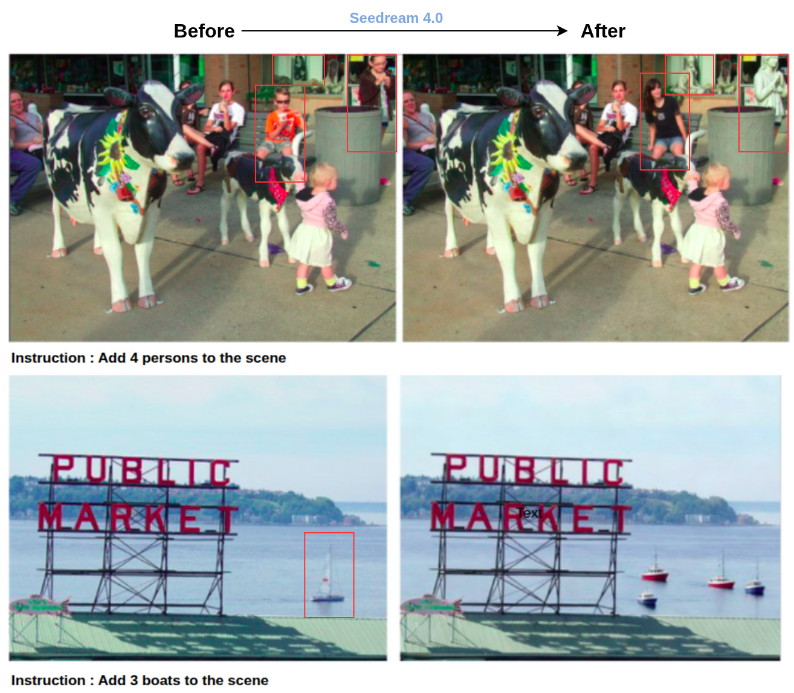
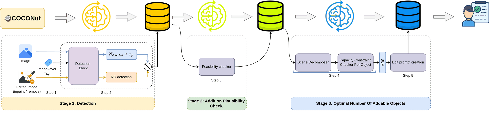
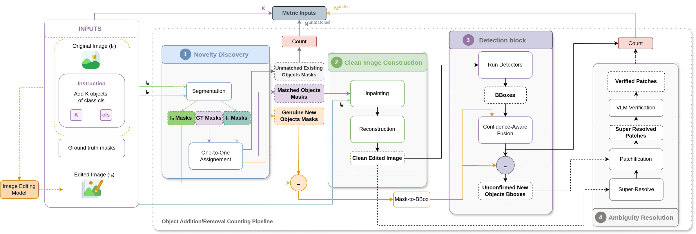

<p align="center">
  <picture>
    <source media="(prefers-color-scheme: dark)" srcset="docs/static/images/logo-dark.svg">
    
  </picture>
</p>

<h1 align="center">ABACUS</h1>

<p align="center">
  <b>A Benchmark for Image Editing Models to Assess Object Category and Counting Under Scene Conservation</b>
</p>

<p align="center">
  Aymen Lassoued,
  Angelique Loesch,
  Romaric Audigier
  <br>
  Université Paris-Saclay, CEA, List, F-91120 Palaiseau, France
  <br>
  <b>WACV 2027</b>, Evaluations and Datasets track
</p>

<p align="center">
  
</p>

<p align="center">
  <a href="https://cea-list.github.io/ABACUS/"></a>
  
  <a href="https://huggingface.co/datasets/Aymen-Lassoued/ABACUS_Bench"></a>
  <a href="LICENSE"></a>
</p>

<p align="center">
  
</p>

<p align="center"><sub>
Asked to <i>add 4 persons</i> and <i>add 3 boats</i>, a leading editor modifies or removes existing objects of the target category (red boxes) instead of only adding new ones.
VLM judges and agentic evaluators still mark these edits as successful. ABACUS identifies both as failures.
</sub></p>

## Overview

Instruction-based image editors can now add, remove, or change objects from a short command. Producing the **exact number** of objects requested, while leaving the rest of the scene untouched, is much harder, and the failures grow sharply with scene complexity and requested count. Existing benchmarks miss these failures: similarity metrics are blind to counts, and VLM judges are themselves poor counters.

**ABACUS** is a benchmark, a judge-free evaluation protocol and a scoring metric for **numerical image editing**.

- **10,944 instructions** over 3,845 COCO images and all 80 categories, covering *add*, *remove* and *change* with target counts from 1 to 15 and easy, medium and hard tiers.
- **Verified ground truth.** Counts come from COCONut panoptic masks confirmed by two independent detectors, and every sample is checked by two annotators.
- **Judge-free protocol.** Each object instance receives a verdict (kept, added, removed or transformed) from segmentation, drift-robust matching and two-detector agreement. No VLM counts objects or judges an edit.
- **One unforgiving score.** Count fidelity, scene consistency and original-category conservation are multiplied, so an edit scores well only when all three hold.
- **Validated against humans.** 0.82 exact-count agreement with human counts, against 0.55 for a top VLM counter and 0.28 for a single open-vocabulary detector.

## Contents

- [Benchmark](#benchmark)
- [Evaluation protocol](#evaluation-protocol)
- [Leaderboard](#leaderboard)
- [Release status](#release-status)
- [Evaluation setup](#evaluation-setup)
- [Citation](#citation)
- [License](#license)

## Benchmark

<p align="center">
  
</p>

Every instruction is paired with a known target count and an instance-level reference:

1. **Ground-truth counts** from COCO images with COCONut panoptic annotations.
2. **Detector-verified audit.** RF-DETR and Co-DETR must both confirm the count, and both must see zero instances after a non-generative inpainting removes the category.
3. **Addition plausibility check** by a VLM, which never sets a count or scores an edit.
4. **Addable capacity**, an upper bound on how many new instances would look natural.
5. **Instruction generation** (for example *add K boats*) followed by **human verification** of feasibility and difficulty tier.

| Tier | Add | Remove | Change | Total |
|:--|--:|--:|--:|--:|
| Easy | 1,159 | 1,146 | 1,000 | 3,305 |
| Medium | 1,363 | 1,340 | 1,128 | 3,831 |
| Hard | 1,374 | 1,308 | 1,126 | 3,808 |
| **Total** | **3,896** | **3,794** | **3,254** | **10,944** |
| Mean K | 3.20 | 2.32 | 2.30 | |
| Max K | 15 | 10 | 10 | |

Difficulty combines three rank-normalized axes (foreground coverage, target capacity and target-object scale), split at the terciles of their sum.

## Evaluation protocol

<p align="center">
  
</p>

Addition and removal share one pipeline of four stages; change couples a removal branch and an addition branch.

| Stage | What it does |
|:--|:--|
| **Novelty discovery** | Presence-gated SAM 3 segments the category in both images. A geometric matcher with Hungarian assignment separates preserved objects from genuinely new ones and repairs missing panoptic labels. |
| **Clean-image construction** | Preserved objects are erased with classical, non-generative inpainting, so only additions remain. |
| **Dual-detector confirmation** | RF-DETR and Co-DETR vote independently on every candidate. An instance counts only when both agree. |
| **Ambiguity resolution** | The rare unconfirmed crop (6.4% of instances) is super-resolved and checked with a yes or no category question. |

A change is credited only **in place**, where a removed source instance and an added target instance coincide, which rejects delete-here, paint-there edits.

Each edit receives

$$\mathrm{Score} = \mathrm{CF}\cdot\mathrm{SC}\cdot\mathrm{OC}, \qquad \mathrm{CF} = \frac{2\min(d,K)}{d+K}, \qquad \mathrm{OC} = 1-\frac{N_{\mathrm{rem}}}{N_{\mathrm{GT}}},$$

where $d$ is the delivered count, $K$ the requested count, $\mathrm{SC}$ the harmonic mean of a RAFT optical-flow term and MS-SSIM on the background, and $N_{\mathrm{rem}}$ the number of pre-existing instances destroyed by the edit.

## Leaderboard

Overall factors are averaged over all 10,944 edits and the Score is their product. Higher is better.

| Model | Type | Count fidelity | Scene consistency | Conservation | **Score** |
|:--|:--|--:|--:|--:|--:|
| Seedream 4.0 | Proprietary | **0.60** | **0.79** | **0.66** | **0.31** |
| Gemini 2.5 Flash Image | Proprietary | 0.59 | 0.77 | 0.64 | 0.29 |
| GPT-Image-1 | Proprietary | 0.56 | 0.75 | 0.62 | 0.26 |
| Qwen-Image-Edit | Open | 0.42 | 0.69 | 0.55 | 0.16 |
| FLUX.1 Kontext | Open | 0.39 | 0.67 | 0.53 | 0.14 |
| Step1X-Edit | Open | 0.34 | 0.64 | 0.50 | 0.11 |
| BAGEL | Open | 0.30 | 0.62 | 0.47 | 0.09 |

Score by operation and difficulty tier, shown as Easy / Medium / Hard:

| Model | Add | Remove | Change |
|:--|:-:|:-:|:-:|
| Seedream 4.0 | **0.55** / **0.42** / **0.28** | **0.46** / **0.31** / **0.20** | **0.38** / **0.25** / **0.14** |
| Gemini 2.5 Flash Image | 0.52 / 0.39 / 0.26 | 0.45 / 0.30 / 0.18 | 0.31 / 0.22 / 0.12 |
| GPT-Image-1 | 0.51 / 0.36 / 0.25 | 0.38 / 0.24 / 0.17 | 0.31 / 0.18 / 0.11 |
| Qwen-Image-Edit | 0.35 / 0.23 / 0.13 | 0.26 / 0.18 / 0.08 | 0.18 / 0.11 / 0.05 |
| FLUX.1 Kontext | 0.30 / 0.20 / 0.12 | 0.24 / 0.14 / 0.08 | 0.14 / 0.09 / 0.05 |
| Step1X-Edit | 0.24 / 0.16 / 0.10 | 0.18 / 0.12 / 0.07 | 0.11 / 0.06 / 0.03 |
| BAGEL | 0.20 / 0.13 / 0.08 | 0.14 / 0.08 / 0.05 | 0.10 / 0.06 / 0.03 |

The three proprietary models are statistically tied (overlapping 95% bootstrap intervals). Even the strongest editor delivers the exact requested count on fewer than half of the edits.

**Agreement with human counts** (600 human-annotated edits):

| Evaluator | Easy | Medium | Hard | Overall |
|:--|--:|--:|--:|--:|
| Grounding-DINO (single detector) | 0.37 | 0.26 | 0.23 | 0.28 |
| Qwen3.6-27B, thinking (solo VLM) | 0.71 | 0.54 | 0.45 | 0.55 |
| **ABACUS (ours)** | **0.89** | **0.82** | **0.76** | **0.82** |

## Release status

- [x] Project page
- [ ] Evaluation code
- [x] [Benchmark dataset](https://huggingface.co/datasets/Aymen-Lassoued/ABACUS_Bench) on the Hugging Face Hub
- [ ] Paper

Watch or star this repository to be notified when the code is released.

## Evaluation setup

### Models used by the protocol

| Component | Role | Checkpoint |
|:--|:--|:--|
| SAM 3 | presence-gated segmentation | `facebook/sam3` |
| RF-DETR 2X-Large | detector (consensus) | `RFDETR2XLarge` (`rfdetr` package) |
| Co-DETR ViT-L | detector (consensus) | `co_dino_5scale_vit_large_coco` |
| Qwen3.6-27B | yes or no category check on rare crops | `Qwen/Qwen3.6-27B` |
| Real-ESRGAN | crop super-resolution | `RealESRGAN_x4plus` |
| RAFT | optical flow for scene consistency | `raft_large` |

### Editing prompt

Every editor receives the benchmark instruction followed by a fixed scene-preservation suffix, so that all models are compared under the same request. For addition:

> Add K {category} to the scene. Keep everything else exactly as-is: same background, lighting, colors, composition, and camera angle. Do not alter, move, or remove existing objects. Only add the new element in a realistic, naturally-placed position.

Removal and change use the analogous instruction with a matching preservation suffix.

### Data

The benchmark is available on the Hugging Face Hub at [Aymen-Lassoued/ABACUS_Bench](https://huggingface.co/datasets/Aymen-Lassoued/ABACUS_Bench), with one configuration per operation (`add`, `remove`, `change`) and one split per difficulty tier (`easy`, `medium`, `hard`).

```python
from datasets import load_dataset

bench = load_dataset("Aymen-Lassoued/ABACUS_Bench", "add", split="hard")
sample = bench[0]
print(sample["prompt"], sample["count"], sample["category"])
```

Each sample provides the source `image`, its COCO `image_id` and `coco_split`, the editing `prompt` and the requested `count`. `add` and `remove` samples name the target `category`; `change` samples name the `source_category` and `target_category`.

ABACUS builds on [COCO](https://cocodataset.org) images and [COCONut](https://xdeng7.github.io/coconut.github.io/) panoptic annotations.

## Citation

If you find ABACUS useful in your research, please cite:

```bibtex
@inproceedings{lassoued2027abacus,
  title     = {{ABACUS}: A Benchmark for Image Editing Models to Assess
               Object Category and Counting Under Scene Conservation},
  author    = {Lassoued, Aymen and Loesch, Angelique and Audigier, Romaric},
  booktitle = {Proceedings of the IEEE/CVF Winter Conference on
               Applications of Computer Vision (WACV)},
  year      = {2027}
}
```

## License

The ABACUS annotations, instructions and evaluation code are released under [CC BY 4.0](LICENSE). Source images and panoptic labels remain under the licenses of [COCO](https://cocodataset.org/#termsofuse) and [COCONut](https://github.com/bytedance/coconut_cvpr2024). Edited images produced by third-party editors are subject to each provider's terms.

## Acknowledgements

Funded by the European Union. Views and opinions expressed are however those of the author(s) only and do not necessarily reflect those of the European Union nor the European Commission. Neither the European Union nor the granting authority can be held responsible for them. This work was supported under the Horizon Europe Project CustomAI (grant number 101226029) and the FactoryIA supercomputer (funded by the Ile-de-France Regional Council).

ABACUS builds on [COCO](https://cocodataset.org), [COCONut](https://xdeng7.github.io/coconut.github.io/), [SAM 3](https://github.com/facebookresearch/sam3), [RF-DETR](https://github.com/roboflow/rf-detr), [Co-DETR](https://github.com/Sense-X/Co-DETR), [RAFT](https://github.com/princeton-vl/RAFT) and [Real-ESRGAN](https://github.com/xinntao/Real-ESRGAN). We thank their authors for making them available.
